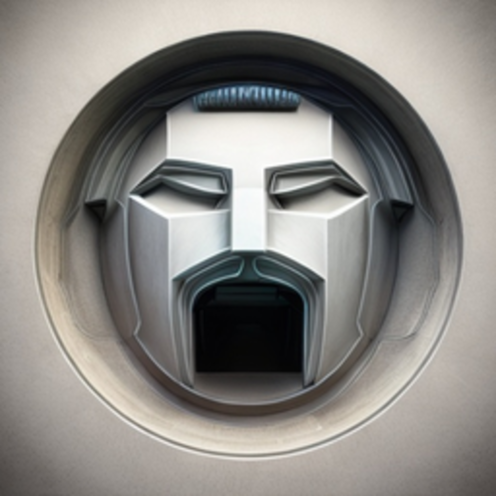

<p align="center">
  
</p>

<h1 align="center">Mad Station</h1>
<p align="center"><strong>One Windows workspace for your AI websites and accounts.</strong></p>

<p align="center">
  <a href="https://github.com/MadLandYT/Mad-Station/releases"></a>
  <a href="https://github.com/MadLandYT/Mad-Station/actions/workflows/release.yml"></a>
  <a href="LICENSE"></a>
</p>

**Current release:** v1.6.3

[**Download the Windows installer (.exe)**](https://github.com/MadLandYT/Mad-Station/releases/download/v1.6.3/Mad-Station-Setup-1.6.3.exe) · [All releases](https://github.com/MadLandYT/Mad-Station/releases) · [Browse the source code](https://github.com/MadLandYT/Mad-Station)

Mad Station is a Windows desktop app for keeping AI websites and their separate account sessions organized in one customizable workspace. It brings quick access, themed homepages, and companion workspaces together without requiring you to manage each site in a separate desktop window.

## Highlights

- **Separate account sessions** — keep persistent sign-ins for different accounts.
- **Customizable homepages** — choose from ten built-in homepage styles, including Isometric World.
- **AI workspaces** — use AI Hub, Model Arena, Prompt Studio, Image Hub, and Video Hub.
- **Everyday tools** — Quick Access, Notes & Tasks, clipboard tools, and downloads.
- **Personal appearance** — adjust themes and shared appearance settings to suit your workspace.
- **One place to manage it** — switch between your accounts and workspace tools from the same application.

Fresh installations start with one account for each supported provider; you can add more accounts later. AI websites are third-party services, so their availability, sign-in requirements, and usage policies still apply.

## Install Mad Station

1. Open the [v1.6.3 release page](https://github.com/MadLandYT/Mad-Station/releases/tag/v1.6.3).
2. Download **Mad-Station-Setup-1.6.3.exe**.
3. Run the installer and follow the setup prompts.
4. Open Mad Station and add or select the accounts you use.

**Windows installer notice:** this release is not code-signed. Windows may show an unverified-publisher or SmartScreen warning. Only download the installer from this project's official GitHub Releases page.

## Build from source

The project pins **Node.js 22.16.0** in `.node-version` and uses **npm 10.9.2**.

On Windows, install that Node.js version, then run:

```powershell
git clone https://github.com/MadLandYT/Mad-Station.git
cd Mad-Station
npm install --global npm@10.9.2
npm ci
npm test
npm run dist
```

The installer is generated under `dist/` as `Mad-Station-Setup-1.6.3.exe`. See the [development environment guide](docs/development/DEVELOPMENT_ENVIRONMENT.md) for more setup and troubleshooting details.

## Project links

- [Documentation index](docs/README.md)
- [Architecture and module guide](docs/architecture/CORE_SYSTEM.md)
- [Security notes](docs/security/SECURITY_AUDIT.md)
- [Third-party licenses and notices](docs/licenses/THIRD_PARTY_NOTICES.md)
- [Report a bug or suggest an improvement](https://github.com/MadLandYT/Mad-Station/issues)

## License

Mad Station is released under the [MIT License](LICENSE). Included third-party components may have their own licenses; see [Third-party notices](docs/licenses/THIRD_PARTY_NOTICES.md).
